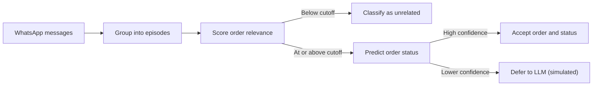
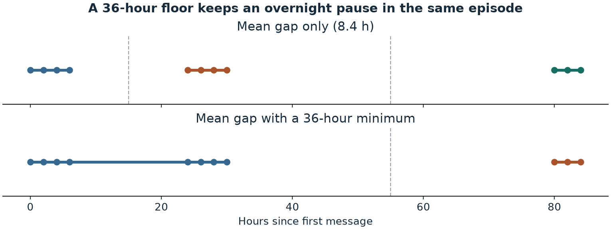
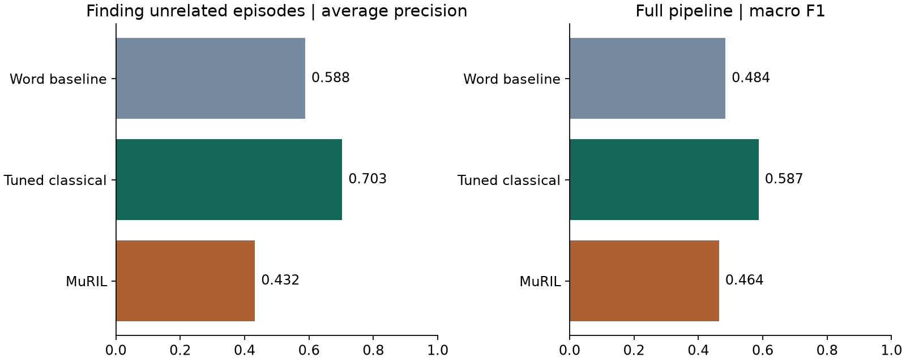
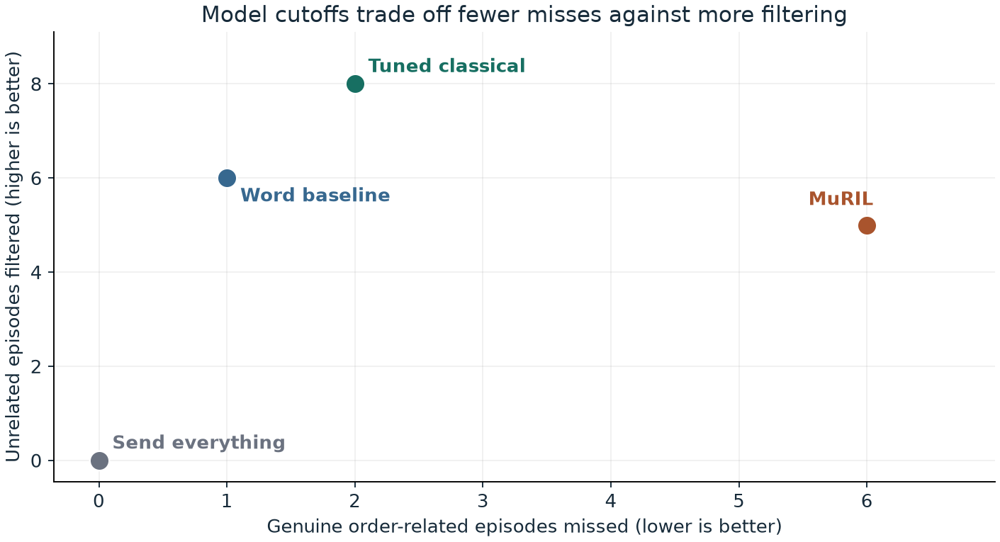
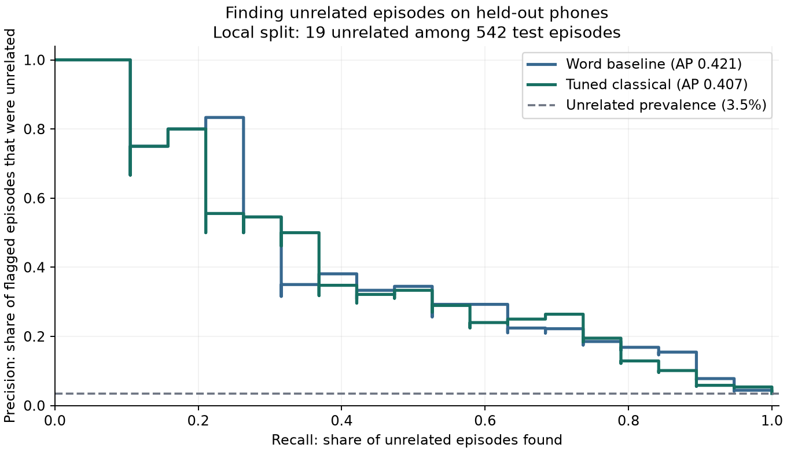
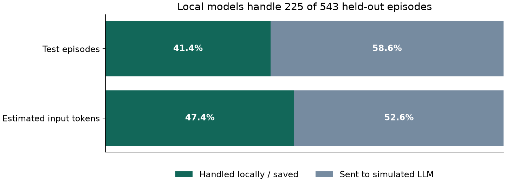
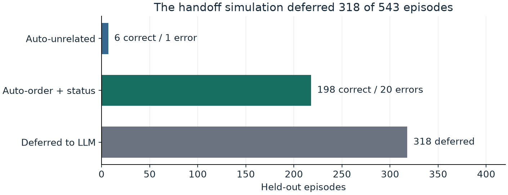

# WhatsApp order parser

A retail pharmacy receives orders through WhatsApp alongside stock inquiries, greetings, and unrelated messages. This project turns those chats into episodes, identifies the ones that need the pharmacy's attention, and classifies the stage of each order. I tested when a local model can make the call and when a larger language model would be worth using.

| Dataset | Evaluation | Estimated input-token savings |
| --- | --- | --- |
| 17,498 messages across 1,131 chats | 543 test episodes from held-out phones | 47.4% in the handoff simulation |

## From messages to orders

The frozen dataset contains **17,498 messages across 1,131 chats**. I merged a read-only database export with WhatsApp archives, deduplicated messages, and grouped them by verified phone number. Within each chat, a new episode starts when a pause exceeds both **36 hours** and that chat's average gap. The floor keeps routine overnight pauses from splitting one conversation.

In this synthetic example, the 18-hour pause stays inside the first episode and the 50-hour pause starts a new one.

### How I labeled the data

I used large language models to propose **silver labels**, or working labels, from message text, who sent it, and saved attachment descriptions. I wrote business rules for ambiguous cases. For example, a stock question counts as order-related but stays at `inquiry`, while a request to pack or send an item can establish `confirmed`. I reviewed flagged cases and disagreements, recorded corrections in audit files, and kept **39 unresolved order-level cases** out of the modeling set. That left **2,707 episodes**. The labels combine model judgments and targeted human review, so the scores measure agreement with a reviewed reference set.

## What worked

I kept all episodes from a phone in the same split, so the models were evaluated on separate phone groups. The **tuned classical pipeline** was strongest on this Colab run. A linear SVM used word and character features to flag unrelated messages, while logistic regression predicted the order stage. It found **8 of 13 unrelated episodes** and missed **2 of 530 order-related episodes** at its validation-selected cutoff. The simpler word baseline missed only one order, so I used it as the relevance filter in a follow-up handoff experiment and paired it with the tuned status classifier.

### Precision–recall across cutoffs

Here, **recall** is the share of unrelated episodes caught. **Precision** is the share of flagged episodes that were actually unrelated. The dashed line shows how often an unrelated episode occurs in the test set. This local rerun used a different phone-grouped split from the Colab run above, with 19 unrelated episodes out of 542. It compares the two classical models. The Colab notebook plots the same curves for all three models, including MuRIL, in its final comparison.

## Where an LLM could help

The local system accepted an unrelated label when the order score was below **0.8968**. It accepted an order and its status when the order score cleared that cutoff and the status score was at least **0.8772**. Everything else went into the simulated LLM queue. I selected both cutoffs on validation phones and measured the result on test phones.

On **543 held-out episodes**, the local models handled **225** and deferred **318 (58.6%)**. The system incorrectly filtered **1 of 530 genuine order-related episodes**, and **20 of the 218** automatically accepted orders had an incorrect order or status prediction (**9.2%**). The simulation estimated **47.4% fewer input tokens** than sending everything to an LLM. This uses transcript lengths estimated with the MuRIL tokenizer and excludes prompt overhead, output tokens, and provider pricing. No transcripts were sent to an LLM, and the experiment did not measure production savings or LLM accuracy.

The evaluation figures use aggregate results from the executed Colab notebook.

## What the results support

The benchmark uses completed episodes. A live system making decisions while messages are still coming in would need its own evaluation. The handoff comparison is exploratory because I chose the filter after seeing the earlier held-out results and reused that split. A fresh, independently reviewed batch would test whether the tradeoff holds, especially for the 13 unrelated test episodes and rare fulfillment statuses.

The [notebook](WhatsApp%20order%20parser%20colab.ipynb) contains the segmentation, model benchmark, and handoff simulation. The confidential dataset and checkpoints are excluded. Running the notebook requires authorized access to the private episode archive. The figures show the recorded Colab run.
